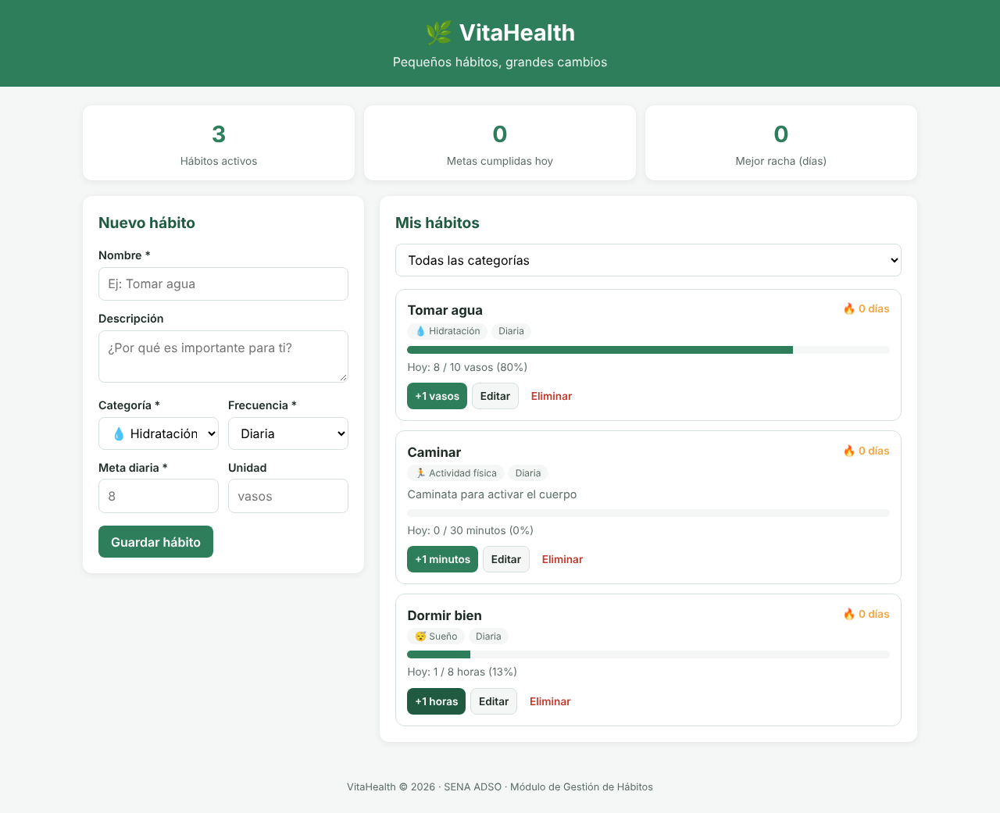

# 🌿 VitaHealth – Módulo de Gestión de Hábitos

Aplicación **web** de hábitos saludables desarrollada en el programa **Análisis y Desarrollo de Software (ADSO) – SENA**.
Este repositorio contiene la codificación del **Módulo de Gestión de Hábitos**, correspondiente a la evidencia
**GA7-220501096-AA3-EV01 – Codificación de módulos del software stand-alone, web y móvil**.

| | |
|---|---|
| **Aprendiz** | Ingri Daniela Rojas Sánchez |
| **Equipo** | Luisa Fernanda Betancur Idarraga · Luna Michell Montealegre |
| **Instructor** | Roberto Echeverri Arroyave |
| **Repositorio** | https://github.com/Vitahealth05/vitahealth-habitos |

Corresponde al **seguimiento de hábitos diarios** del módulo funcional *"Hidratación, sueño y hábitos"* definido en
los estándares de codificación del equipo (AA1-EV02). Los módulos anteriores (cuentas, perfil, hidratación y
actividad) están en el repositorio Java `vitahealth-web`; este módulo usa **Express** y vive en un repositorio propio.
Ver [`docs/TRAZABILIDAD.md`](docs/TRAZABILIDAD.md).



---

## 1. Tecnologías y framework

| Capa | Tecnología |
|---|---|
| Backend (API REST) | **Node.js 18+** con el framework **Express 4** |
| Frontend | HTML5, CSS3 (convención BEM) y JavaScript (ES2022) |
| Persistencia | Archivo JSON a través de un repositorio (reemplazable por MySQL) |
| Pruebas | `node:test` (runner nativo de Node.js) |
| Estándares | ESLint 9, Prettier, EditorConfig |
| Versionamiento | Git + GitHub (Conventional Commits) |

## 2. Funcionalidades del módulo

- **Registrar** un hábito saludable (nombre, descripción, categoría, frecuencia, meta y unidad).
- **Consultar** los hábitos y **filtrarlos** por categoría.
- **Editar** y **eliminar** hábitos (con confirmación).
- **Registrar el cumplimiento** diario (botón "+1").
- **Ver el progreso** del día (barra de porcentaje) y la **racha** de días seguidos cumpliendo la meta.

## 3. Arquitectura (MVC por capas)

```
Navegador (public/)  ──fetch──▶  Rutas ─▶ Controlador ─▶ Servicio ─▶ Repositorio ─▶ data/habitos.json
                                 (routes)  (controllers)   (services)   (repositories)
                                                 ▲
                                    Modelo + validaciones (models)
```

```
vitahealth-habitos/
├── src/
│   ├── app.js                    # Construye la app Express y une las capas
│   ├── server.js                 # Punto de entrada (abre el puerto)
│   ├── config/index.js           # Configuración y variables de entorno
│   ├── models/habito.js          # Entidad Habito y reglas de validación
│   ├── repositories/             # Acceso a datos (JSON)
│   ├── services/                 # Lógica de negocio (casos de uso, racha, progreso)
│   ├── controllers/              # Peticiones/respuestas HTTP
│   ├── routes/                   # Definición de endpoints REST
│   └── middlewares/              # Manejo centralizado de errores
├── public/                       # Interfaz web (HTML, CSS, JS)
├── tests/                        # Pruebas unitarias
├── data/habitos.ejemplo.json     # Datos de ejemplo
└── docs/TRAZABILIDAD.md          # Relación con los artefactos del ciclo de vida
```

## 4. Instalación y ejecución

Requisitos: **Node.js 18 o superior** y **Git**.

```bash
git clone https://github.com/Vitahealth05/vitahealth-habitos.git
cd vitahealth-habitos
npm install          # instala Express y las herramientas de desarrollo
npm start            # inicia el servidor
```

Abrir **http://localhost:3000** en el navegador.

Para cargar datos de ejemplo (opcional):

```bash
# Windows (PowerShell)
Copy-Item data/habitos.ejemplo.json data/habitos.json
# Linux / macOS
cp data/habitos.ejemplo.json data/habitos.json
```

Otros comandos:

| Comando | Descripción |
|---|---|
| `npm run dev` | Reinicia el servidor al guardar cambios |
| `npm test` | Ejecuta las pruebas unitarias |
| `npm run lint` | Revisa el estándar de codificación con ESLint |
| `npm run format` | Da formato al código con Prettier |

## 5. API REST

Formato de respuesta: `{ "ok": true, "datos": ... }` o `{ "ok": false, "mensaje": "...", "detalles": [...] }`.

| Método | Endpoint | Descripción | Respuesta |
|---|---|---|---|
| GET | `/api/salud` | Estado del servicio | 200 |
| GET | `/api/catalogos` | Categorías y frecuencias | 200 |
| GET | `/api/habitos?categoria=` | Listar hábitos | 200 |
| GET | `/api/habitos/:id` | Consultar un hábito | 200 / 404 |
| POST | `/api/habitos` | Crear hábito | 201 / 400 |
| PUT | `/api/habitos/:id` | Actualizar hábito | 200 / 400 / 404 |
| DELETE | `/api/habitos/:id` | Eliminar hábito | 200 / 404 |
| POST | `/api/habitos/:id/registros` | Registrar cumplimiento `{ "cantidad": 1, "fecha": "AAAA-MM-DD" }` | 201 / 400 / 404 |

Ejemplo de creación:

```json
POST /api/habitos
{
  "nombre": "Tomar agua",
  "descripcion": "Mantenerme hidratada",
  "categoria": "hidratacion",
  "frecuencia": "diaria",
  "meta": 8,
  "unidad": "vasos"
}
```

## 6. Estándares de codificación aplicados

- Nombres en **español** y **camelCase** para variables/funciones, **PascalCase** para clases, **MAYÚSCULAS** para constantes.
- Comentarios **JSDoc** en cada archivo, función y clase.
- Separación de responsabilidades (rutas, controladores, servicios, repositorios, modelos).
- Validación de datos en el servidor y respuestas de error uniformes.
- Escape de HTML en la interfaz para prevenir XSS.
- Reglas de ESLint (`eqeqeq`, `prefer-const`, `no-var`, `curly`) y formato con Prettier.
- Mensajes de commit con **Conventional Commits** (`feat:`, `fix:`, `docs:`, `test:`, `chore:`).

## 7. Control de versiones

Se sigue el flujo de ramas del estándar del equipo:

| Rama | Uso |
|---|---|
| `main` | Código estable y listo para entregar |
| `develop` | Integra las funcionalidades terminadas |
| `feature/habitos-gestion` | Desarrollo del módulo de gestión de hábitos |

```bash
git log --oneline --graph --all   # ver el historial y las ramas
```

Publicar en GitHub (primera vez):

```bash
git push -u origin main
git push origin develop feature/habitos-gestion
```

## 8. Licencia

MIT – Proyecto académico SENA 2026.
